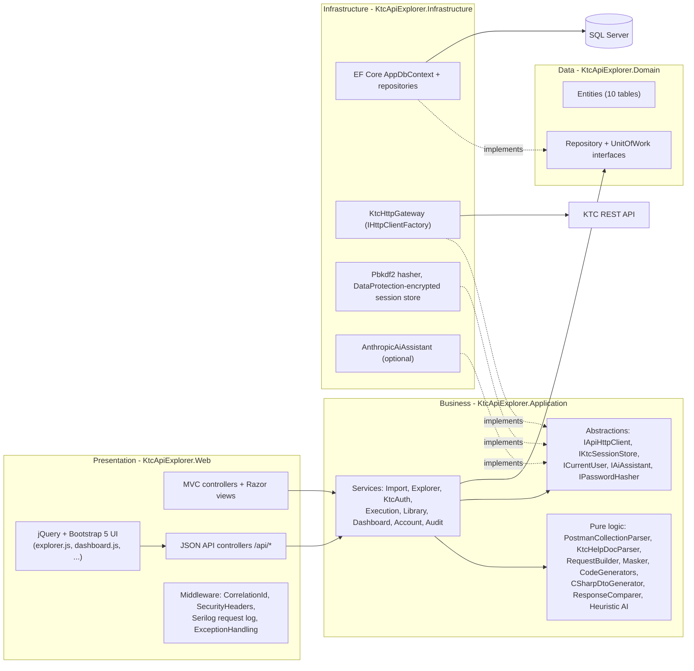

# Architecture

Clean Architecture with four layers; dependencies point **inward** (Web → Infrastructure/Application → Domain).



| Layer | Project | Responsibility | References |
|---|---|---|---|
| Presentation | `KtcApiExplorer.Web` | Controllers, views, JS, middleware, composition root (`Program.cs`) | Application, Infrastructure |
| Business | `KtcApiExplorer.Application` | Use-cases, DTOs, parsing, code generation, masking, authorization rules, abstractions | Domain |
| Data (core) | `KtcApiExplorer.Domain` | Entities, repository interfaces, read models | – |
| Infrastructure | `KtcApiExplorer.Infrastructure` | EF Core/SQL Server, repositories, outbound HTTP, session encryption, optional LLM | Application |

SOLID in practice: every service depends on abstractions (`IApiHttpClient`, `IEndpointRepository`, …) injected by DI; the AI provider is swappable
(`IAiAssistant`: offline heuristic ⇄ Claude) without touching callers; parsers and generators are pure static functions that are unit-tested in isolation.

## Request flow: executing an API

```mermaid
sequenceDiagram
  participant B as Browser (explorer.js)
  participant W as Web (ExplorerApiController)
  participant X as ApiExecutionService
  participant A as KtcAuthService
  participant G as KtcHttpGateway
  participant K as KTC REST API
  participant D as SQL Server
  B->>W: POST /api/explorer/execute {endpointId, path, query, headers, body} + CSRF header
  W->>X: ExecuteAsync
  X->>X: role check (Viewer: GET/HEAD only)
  X->>A: GetValidSessionAsync()
  A->>A: decrypt session; if < 90 s left -> Relogin/Login
  A-->>X: KtcSession (token never leaves the server)
  X->>X: RequestBuilder: url from collection base + route, escape params, host guard, inject Bearer
  X->>G: SendAsync
  G->>K: HTTP (no redirects, size-capped, timeout)
  K-->>G: response
  G-->>X: status, headers, body, duration
  X->>D: ApiExecutions row (headers/body MASKED) + AuditLogs row
  X-->>B: result (body + masked body)
```

## Importing the KTC collection

The supplied Postman export is unusual and the importer handles it explicitly:

* **805 requests, no folders, every `url` empty.** Method and route live in the item *name* (`GET api/v1/Action/{id}`); query strings use help-page style placeholders
  (`…?commandtypeID={commandtypeID}&actionstatus={actionstatus}`). Names are HTML-escaped (`&amp;`).
* **Overloads.** 40 endpoints share method + path and differ only by query parameters (e.g. four `GET api/v1/Campaign?…` variants). Identity is therefore
  **(Method, RouteTemplate, QuerySignature)**; keying on method + path alone would silently drop them.
* **Two root routes** (`GET` and `HEAD` with empty route) are valid.
* **Folders / descriptions** come from the optional *KTC help documentation* HTML (110 controller groups, 753 descriptions). Without it, the third route segment is used
  (`api/v1/<Controller>`). Real Postman folder trees (nested) are honoured when present.
* **Re-import** upserts by identity, so favourites, templates, test cases and history survive; endpoints no longer in the file are deactivated, not deleted.

## Data model

`Roles` 1—* `Users` · `ApiCollections` 1—* `ApiFolders` (self-referencing) · `ApiCollections` 1—* `ApiEndpoints` · `ApiEndpoints` 1—* `ApiExecutions` ·
`Users` *—* `ApiEndpoints` via `ApiFavorites` · `RequestTemplates`, `TestCases` (per user/endpoint) · `AuditLogs` (no FKs so history outlives users).
Scripts: `database/001_schema.sql` (generated from the EF model), `002_seed_roles.sql`, `003_maintenance.sql`.
